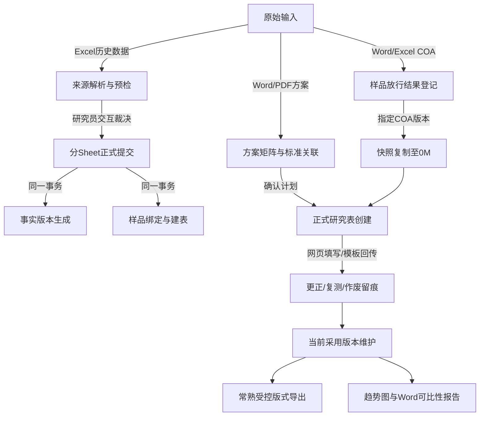
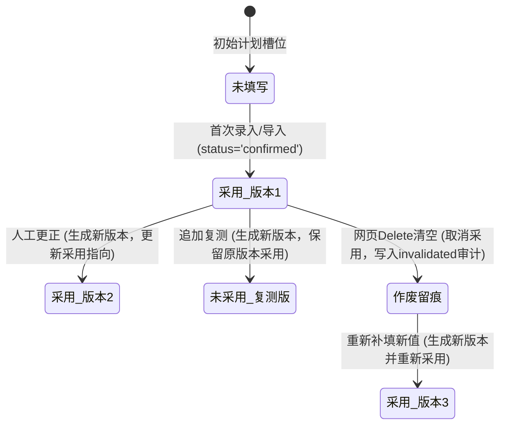

# 稳研工作台交付物二：业务流程与数据关系设计

## 1. 业务主流程图

---

## 2. 核心实体模型与数据谱系 (Data Lineage)

### 2.1 实体关系与数据表映射

| 业务实体 | SQLite 核心表 | 关键字段与联合主键 | 业务约束 |
|---|---|---|---|
| **项目与别名** | `workflow_projects` `project_aliases` | `project`, `purpose`, `created_at` `alias`, `canonical_project` | `purpose` 支持 `'formal'` 与 `'sandbox'`；别名映射禁止歧义 |
| **样品实体** | `sample_entities` | `id`, `project`, `batch`, `material_scope`, `stage`, `specification`, `deleted_at` | 样品唯一由 (project, batch, scope, stage, spec) 确定；软删除通过 `deleted_at` 记录 |
| **质量标准** | `specifications` `current_specifications` | `id`, `project`, `material_scope`, `version`, `clauses_json` | 每个 (project, material_scope) 显式关联一份当前标准版本 |
| **检验项目字典** | `assay_definitions` `assay_components` | `project`, `item_id`, `name_zh`, `name_en`, `method`, `unit`, `norm_signature` | 支持双语名称、方法规范化签名以及别名字典映射 |
| **研究计划表** | `business_worksheets` | `id`, `project`, `name`, `condition`, `sample_id`, `identity_json`, `plan_rows_json`, `deleted_at` | 正式表必须绑定 `sample_id`；软删除记录 `deleted_at` |
| **COA放行快照** | `sample_release_results` | `sample_id`, `project`, `item_id`, `reporting_basis`, `coa_version`, `raw_value` | 存储放行检测结果版本，供稳定性 0M 独立快照提取 |
| **事实版本与作废** | `workflow_versions` `workflow_invalidated_versions` | `id`, `project`, `slot_id`, `value`, `operator` `version_id`, `reason`, `invalidated_by`, `invalidated_at` | 事实版本不可物理篡改；单元格作废、行作废生成审计记录 |
| **槽位别名桥接** | `slot_identity_bridges` | `legacy_slot_id`, `canonical_slot_id`, `project` | 历史结果位置平滑过渡，无需改写历史事实的 `slot_id` |

---

## 3. 关键业务状态机与设计机制

### 3.1 单元格版本与作废流转状态机

### 3.2 0M 复制与独立快照机制
1. **来源解耦**：
   - 当调用 `POST /api/v1/worksheets/{sheet_id}/copy-coa-to-0m` 时，后端从 `sample_release_results` 提取匹配的 `raw_value` 和 `coa_version`。
   - 生成对应的正式结果版本记录（`workflow_versions`），在来源元数据中注明 `source_kind='coa_copy'`, `coa_version=X`。
   - 写入研究表的 0M 槽位并设为当前采用。
2. **防覆盖隔离**：
   - 若后续用户在质量控制系统更新了该样品的 COA（如出具 Revision 2），该操作仅更新 `sample_release_results` 中的放行记录，**绝对不会静默覆盖** 已固化至稳定性研究表 0M 槽位的事实版本。

### 3.3 数据库迁移历史（Migration Lineage）
- **v17**：引入检项标准化签名 `norm_signature`、COA 样品放行映射表 `sample_release_results` 及槽位别名映射 `slot_identity_bridges`。
- **v18**：建立独立的结果作废留痕事件审计表 `workflow_invalidated_versions` 及项目别名控制表 `project_aliases`。
- **v19**：在 `business_worksheets` 与 `sample_entities` 增加 `deleted_at` 软删除字段；在 `workflow_projects` 增加 `purpose` 字段（`formal` / `sandbox`）。
- **v20**：创建 `current_specifications` 表，显式绑定各项目与材料阶段（DS/DP/Placebo/Reference）的有效质量标准。
- **迁移事务性**：所有迁移在 SQLite 单事务中运行，出现任何 DDL 异常自动回滚，保持库模式与元数据的一致性。
